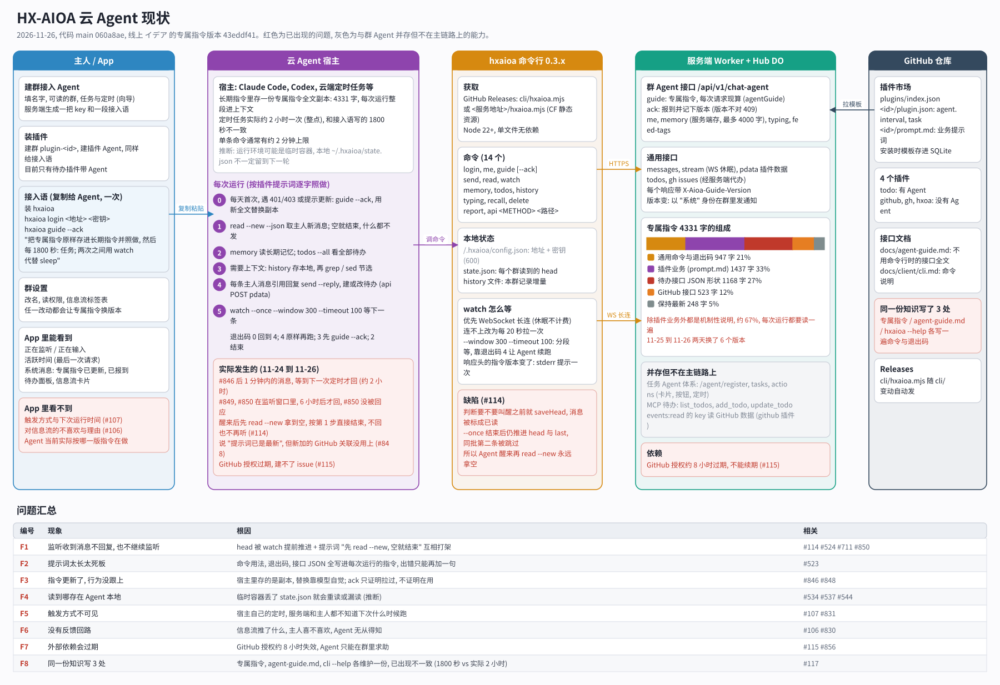

# 云 Agent 设计统一 (草案, #117)

讨论统一在 #117, 本文只放定下来的结论和图。

## 已定

- 知识做成 skill, 装一次: 核心 skill 在仓库 `skills/hx-aioa/`, 插件的业务契约跟着插件放在 `plugins/<id>/skill/`。
- skill 由 hxaioa 直接从 Git 下载 (`hxaioa skill install`), 按插件版本固定, 可用 `HXAIOA_GIT_BASE` 换镜像; CF 不托管 skill。
- 提示词分两种: 接入语 (创建云 Agent 时用一次) 与触发语 (定时任务每次一句)。
- 写法遵守 hx-make-skill: L1/L2/L3 分层, 接口细节放 references 按需读, 文本过标点门禁。

## 待定

- 处理游标的判定: 回复覆盖 (`send --covers`) 加显式 `done` 是否够用。
- 不支持 skill 的宿主: 退化为 `hxaioa guide` 打印 SKILL.md 全文 + 简报。
