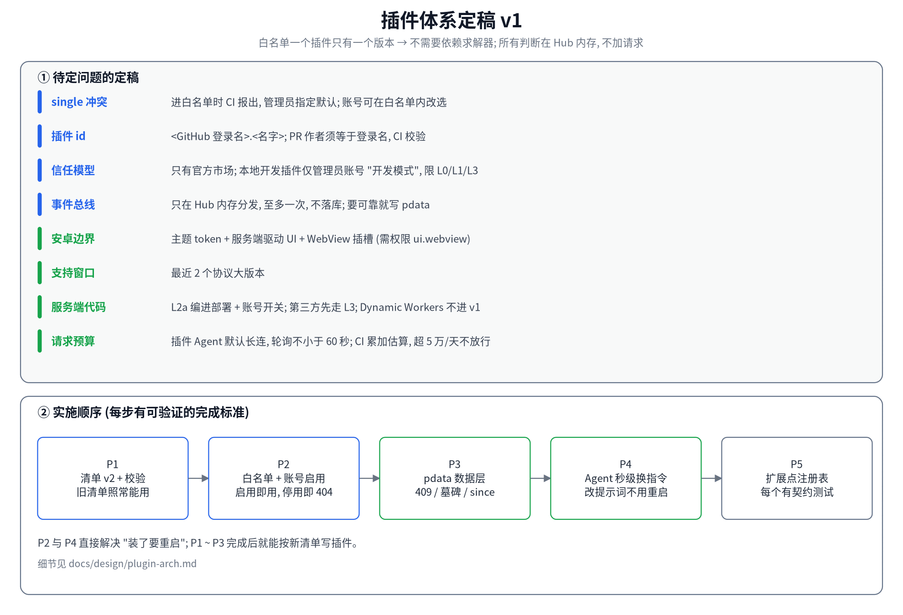
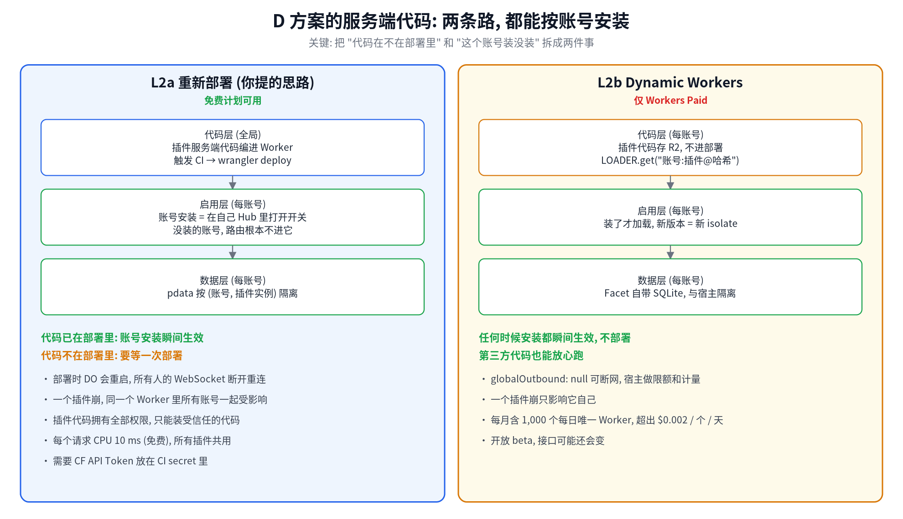
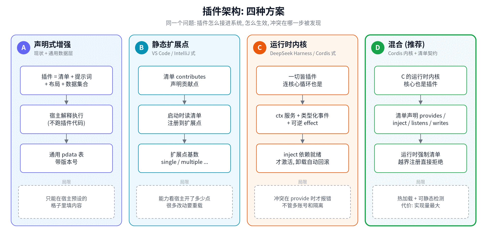
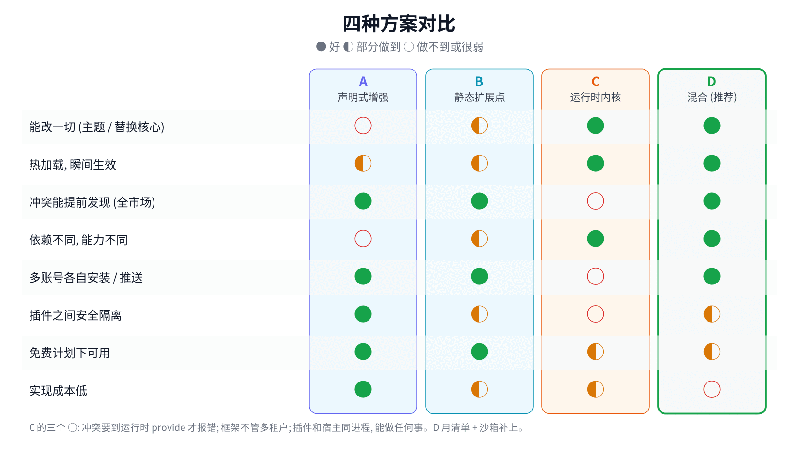

# 插件体系重新设计 (D 方案) 定稿 v1

讨论记录见 issue [#99](https://github.com/HengXin666/HX-AIOA/issues/99)。本文是定稿, 写插件和实现都以本文为准; 有改动先改本文。



## 1. 结论一览

| 问题 | 定稿 |
| --- | --- |
| 方案 | D: Hub 内的运行时内核 (服务 + 事件 + 可撤销注册) + 清单在运行时强制 |
| 谁决定能用什么 | 管理员白名单 (全局, 多管理员取并集), 每个插件在白名单里**只有一个版本** |
| 谁决定装什么 | 每个账号从白名单里自己启用, 瞬间生效, 不部署 |
| 启用状态放哪 | 主 Hub 内存 `Map<账号, Set<插件>>`, Hub 唤醒时从 SQLite 读一次; 判断 0 次查库, 0 次额外 DO 请求 |
| 依赖求解 | v1 不做 PubGrub: 白名单每个插件只有一个版本, 只检查 `engines` 与 `requires` 是否被满足 |
| 服务端代码 | L2a: 白名单里的代码编进部署, 账号开关; 第三方代码先走 L3 Agent; Dynamic Workers (L2b) 不进 v1 |
| 安卓 "改一切" 的边界 | 主题 token + 服务端驱动 UI (工作台 schema) + WebView 插槽; WebView 插槽要单独权限 `ui.webview` |
| `single` 扩展点冲突 | 不搞 "后装覆盖": 放进白名单时 CI 报冲突, 管理员指定默认提供者; 账号可在白名单里的提供者之间改选 |
| 插件 id | `<GitHub 登录名小写>.<名字>`, 例 `hengxin666.notes`; 市场 PR 作者必须等于该登录名, CI 校验 (维护者除外); 现有 `todo` 已迁为 `hengxin666.todo` (#101), 旧 id 只作路径别名 |
| 信任模型 | v1 只有官方市场 (仓库 PR + CI + 管理员放行); 本地开发插件只能在管理员自己的账号开 "开发模式", 只允许 L0 / L1 / L3; 第三方市场源不进 v1 |
| 事件总线 | 只在 Hub 内存分发, 至多一次, 不落库; 要可靠就由插件自己写 `pdata` |
| 版本支持窗口 | 最近 2 个协议大版本 |
| 版本兼容 | 启动不等更新; 握手三档 (兼容 / 建议更新 / 低于底线), 低于底线只灰掉新功能; 只有安全漏洞才完全拒绝 |

## 2. 清单 `plugin.json` v2

在现有字段 (`id name summary version icon tags author readme prompt group agent space`) 上**只加不改**, 旧清单按 `api: "1"` 理解, 照常能用。

```jsonc
{
  "id": "hengxin666.todo",
  "version": "2.0.0",
  "api": "2",                                   // 清单 schema 版本
  "engines": { "aioa": "^2" },                  // 需要的宿主协议大版本 (当前 PROTOCOL_VERSION = 2)
  "requires": { "service:chat.messages": "^1" },
  "optional": { "service:calendar.events": "^1" },
  "provides": { "service:todo.items": "1.0.0" },
  "contributes": {
    "commands":   [{ "id": "hengxin666.todo.add", "title": "加待办" }],
    "widgets":    [{ "id": "hengxin666.todo.list", "schema": "widgets/list.json" }],
    "settings":   [{ "id": "hengxin666.todo.remind", "type": "boolean", "default": true }],
    "collections":[{ "name": "items", "schema": "data/items.json", "index": ["state"] }],
    "push.route": [{ "id": "hengxin666.todo.due", "writes": ["route"] }]
  },
  "permissions": ["data:own", "push:send"],     // 见第 6 节
  "budget": { "cron": "0 * * * *", "agentPoll": 0 } // 见第 7 节, 市场 CI 累加
}
```

扩展点基数沿用 issue 正文 4.2 (`single` / `multiple` / `layered` / `pipeline`)。命名空间: 所有 id, 设置键, 集合名都以插件 id 开头, 撞名 = 冲突, CI 拒绝。

## 实现状态

接口见 `docs/api/plugins.md`。

| 项 | 状态 |
| --- | --- |
| P1 清单 v2, 校验, 静态冲突检测, 市场 CI 与预算 | 已实现 |
| P2 白名单, 账号启用 (内存 Set), 单选改选, `plugin_update` 推送 | 已实现; 安装期间被撤销会回滚, 未做通用安装锁 |
| P3 pdata (乐观锁, 墓碑, 增量, 配额, 批量写) | 已实现; rev 由最大 rev 推出, 只在清除时记下限, 每次写入不多写计数行 |
| P4 Agent 长连收到更新秒级醒来 | 已实现 (`hxaioa watch --once`) |
| P5 扩展点注册表, 服务, 事件总线, 可撤销注册 | 已实现; 每个扩展点有契约测试 (`server/test/plugin-ext-contract.test.ts`, 新加扩展点不补测试会失败); 客户端读生效贡献走 `GET /plugin-contrib/{point}`。核心功能 (主题, 推送路由) 改成内置插件未做, 等有第二个提供者时再拆 |
| 现有两个插件迁移 | 待办 #101 已实现: `todo` → `hengxin666.todo` (api 2, 数据在 pdata 的 `items`), 旧 id 作别名, 群与工作台沿用 `plugin-todo`; 一次性迁移在 Hub 唤醒时一个事务里做完, 旧待办接口转发到 pdata 保留一个大版本; 旧接口按调用者账号判断启用。GitHub 接入 #102 已实现: 内置插件 `hengxin666.github`, 清单 `agent` 可选, 主人启用状态门控接口 / webhook / cron (内存判断), 停用 `purge` 清 `gh_*` 表, 升级迁移为主人启用; 安卓按启用状态显示入口, 收 `plugin_update` 刷新。合并主线后第三个: GitHub 授权 (旧 base 插件 `gh`, 主线 #98) 迁为无 Agent 内置插件 `hengxin666.gh`, 提供 `service:gh.issues`, 待办清单 `optional` 声明它; 待办 pdata 行补上主线的 repo / issue / parent / gh / doneAt 与 hold 状态 |
| 客户端处理 `plugin_update` / `pdata_sync` 自动刷新 | 安卓: 待办组件按 `pdata_sync` 增量刷新, 停用或撤销待办清空本地副本; 插件市场与详情收到 `plugin_update` 重拉; GitHub 入口按启用显示。Web 端未做 (Web 客户端未开始) |
| 管理员 (admin 子号) 的市场列表与安装, 账号启用界面 | 安卓已做: 主人与子号都能看市场; 管理员放行 / 撤销 (高危权限单独确认); 每个账号自己启用 (高危权限单独确认), 单选改选; 安装 Agent 只有主人 (群与 Agent 归主人) |
| L2a 服务端插件代码, 握手三档, 支持窗口, 开发模式 | 已实现: 清单 `server: true` + `L2A_PLUGINS` 登记, 放行没部署的返回 `plugin_needs_deploy` (白名单变化不自动触发部署, 新代码走 PR + 部署); 握手 `pv` 与 `welcome.compat` 四档, 窗口 2 个大版本; 开发模式 `/plugin-dev` (只 L0 / L1 / L3, 只开发者自己可见)。详见 `docs/api/plugins.md` |

## 3. 运行时 (主 Hub 内)

- 内核三件事: 服务表 (`provides` / `requires`), 事件总线 (`emits` / `listens`), 可撤销注册 (每次注册返回一个撤销句柄, 卸载 = 按插件撤销全部)。
- 请求进 Hub 后: 解析出账号 → 查内存 Set → 未启用直接 404 (界面不展示), 启用则交给插件。
- 安装 / 卸载 / 升级: 每账号一把锁, 一次 `transactionSync` 写完 (启用记录, 设置默认值, 集合迁移), 失败整体回滚; 修掉现在的重复安装和卸载复活。
- 变化推送: Hub 改完内存后经 WebSocket 推 `plugin_update` (只推给该账号的界面连接与 Agent 长连, 不推安卓后台连接)。

## 4. 热加载

| 层 | 内容 | 生效方式 |
| --- | --- | --- |
| L0 声明 | 提示词, 布局, 主题 token, 文案, 集合 schema | 宿主解释, 收到 `plugin_update` 即生效 |
| L1 客户端 | Web 动态 `import()`; 安卓服务端驱动 UI | 同上, 失败回退到上一版 |
| L2a 服务端 | 白名单代码编进部署 | 白名单变化触发 CI 重新部署; 账号开关不部署 |
| L3 Agent | 插件逻辑跑在用户的 Agent 上 | Agent 长连收到带 `guide` 的 `plugin_update`, `hxaioa watch` 立即提示重拉 (`--once` 时立即醒来), 不再等每天一次 |

## 5. 数据 `pdata`

- 一张表 `pdata(acct, plugin, coll, id, ver, updated, deleted, body)`, 主键 `(acct, plugin, coll, id)`。
- 写入带读到的 `ver`, 不匹配返回 409; 删除写墓碑; 客户端按 `since` 增量同步。
- 只持久化真正的数据, 每次写入算 1 行写入, 计入每天 10 万行预算; 配额按 (账号, 插件) 计。
- 现有 `todo` 表一次性迁移成 `hengxin666.todo` 的 `items` 集合 (#101): 账号 = 主人, id = `<群>:<待办 id>`, 保留原 `updated`; 和改 id 一起在 `transactionSync` 里做, 做完删表并打标记, 重复跑不重复写。

## 6. 权限

`data:own` (自己的集合), `data:read:<插件>.<集合>` (读别人公开的集合, 需用户授权), `push:send`, `net:<域名>` (只对 L2a), `ui.webview`, `core.replace` (替换 `single` 核心扩展点)。后三项是高危, 单独确认。

## 7. 请求预算

所有 HTTP 请求都经 Worker 转发到同一个 Hub DO, 每个请求 = 1 次 Worker 请求 + 1 次 DO 请求; WebSocket 入站消息, cron, RPC 也算 DO 请求。免费额度两者都是每天 10 万 (UTC 0 点重置)。

- 不新增 DO 跳转, 不为插件单独建 DO, 插件不加定时拉取, 变化一律推送。
- 插件 Agent 默认用长连 (`hxaioa watch`), `agent.interval` 只作退路; 退路间隔不小于 60 秒 (20 秒一次一天就是 4,320 次)。
- `budget` 声明 cron 与预计拉取; 市场 CI 按白名单累加估算每天请求, 超过 5 万 (额度一半) 不让进白名单。

## 8. 实施顺序

| 步 | 内容 | 完成标准 |
| --- | --- | --- |
| P1 | 清单 v2 类型与校验 (protocol), 旧清单兼容; 市场 CI 校验命名空间与冲突 | `npm run typecheck`; 旧 `todo` 清单校验通过 |
| P2 | 白名单 + 账号启用 (Hub 内存 Set, 安装锁与事务, `plugin_update` 推送) | e2e: 启用后立刻可用, 停用后立刻 404, 不部署 |
| P3 | `pdata` 通用数据层 + 增量同步; `todo` 迁移 | e2e: 409, 墓碑, since 同步 |
| P4 | Agent 长连收 `plugin_update` 立即换指令; 插件 Agent 改为默认长连 | 改提示词后 Agent 秒级生效, 不用重启 |
| P5 | 扩展点注册表, 核心功能逐个改为内置插件 (主题, 工作台组件, 推送路由先行) | 每个扩展点有契约测试 |

## 附: 选型过程










