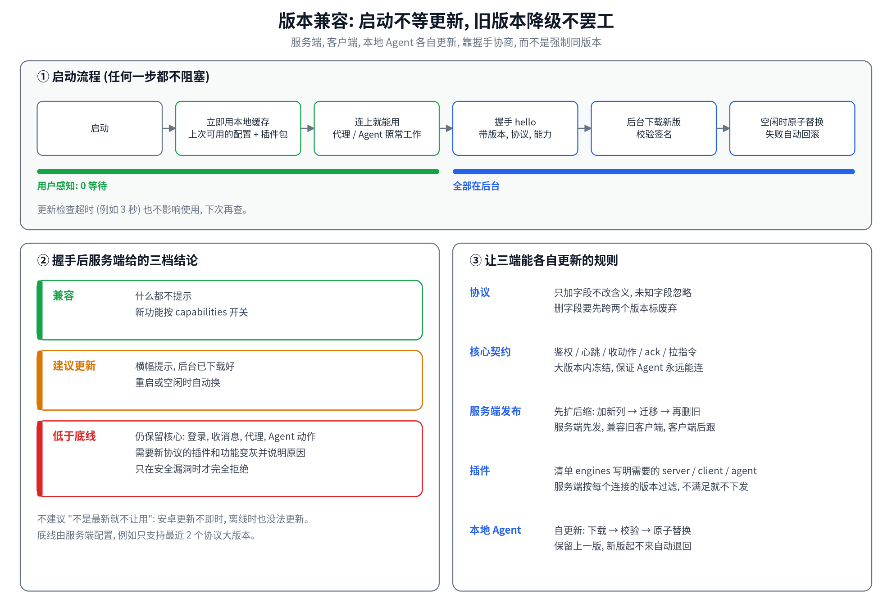

# 插件体系重新设计 (D 方案)

讨论记录见 issue [#99](https://github.com/HengXin666/HX-AIOA/issues/99)。本文只放结论图, 细节以 issue 为准。

## 最终方案

## 请求预算

所有 HTTP 请求都经 Worker 转发到同一个 Hub DO, 所以每个请求 = 1 次 Worker 请求 + 1 次 DO 请求; WebSocket 入站消息, cron, RPC 也算 DO 请求。免费额度两者都是每天 10 万 (UTC 0 点重置)。

插件体系的硬约束:

- 不新增 DO 跳转: 启用判断, 插件钩子, 事件总线都在 Hub 进程内完成。
- 不为插件单独建 DO, 不在插件里加定时拉取; 变化一律 WebSocket 推送。
- 每个插件的清单声明 cron / alarm 频率, 市场 CI 按全部白名单插件累加估算每日请求, 超预算不让进白名单。

## 服务端代码与版本兼容

## 选型过程

